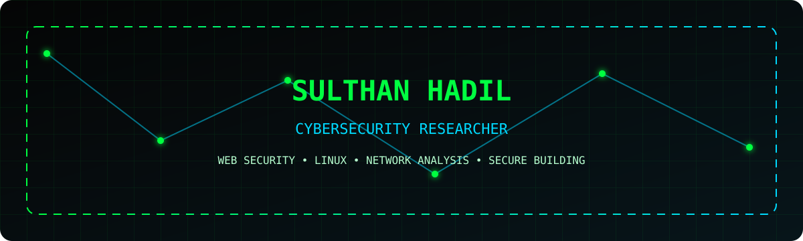
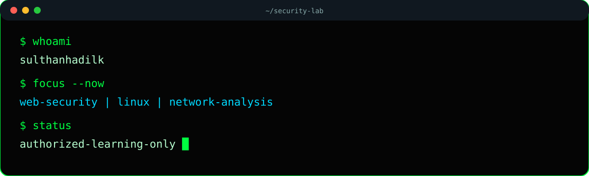
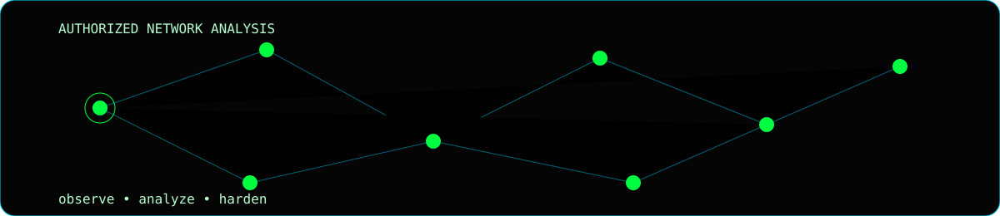

# Sulthan Hadil

### Aspiring Cybersecurity Analyst | Web Security Learner | Full-Stack Builder

  
  
  

## WHOAMI

I’m **Sulthan Hadil**, a BCA graduate from the University of Calicut, building toward an entry-level cybersecurity role. My work combines web application security fundamentals, Linux-based security labs, and practical full-stack development.

I care about authorized testing, responsible disclosure, secure development habits, and documenting technical work clearly.

## CURRENT FOCUS

- Web application security, HTTP, authentication, sessions, and access control
- Linux and Kali Linux workflows for ethical security learning labs
- Network security and vulnerability assessment fundamentals
- Secure coding, remediation, and reproducible technical workflows

## CYBERSECURITY ARSENAL

  
  
  
  
  
  
  

**Development:** JavaScript, React, Vite, Tailwind CSS, Node.js, Express, WebSockets, LiveKit, Git, Postman.

> Security tools listed here represent current learning and practice areas. Testing is authorized only.

## FEATURED PROJECTS

### [Stranger Chat Web Application](https://github.com/sulthanhadilk/stranger-chat-web)

Real-time 1:1 chat architecture and signaling patterns.

- **Frontend:** React 18, Vite, React Router, LiveKit client/components
- **Backend:** [stranger-backend](https://github.com/sulthanhadilk/stranger-backend), Node.js/Express, WebSocket, Redis, LiveKit server SDK
- **Security-aware engineering:** validation, rate limiting, Helmet, CORS, and environment configuration

### [Attendance Management System](https://github.com/sulthanhadilk/attendence-front)

A full-stack attendance platform with a React frontend and Express/MongoDB backend.

- **Frontend:** React, Vite, Bootstrap, React Router, Axios, Chart.js, TensorFlow.js
- **Backend:** [attendance-back](https://github.com/sulthanhadilk/attendance-back), Node.js, Express, MongoDB/Mongoose, JWT, bcryptjs
- **Features:** role-oriented workflows, attendance, exams/results, reports, authentication, and input validation

## GITHUB ANALYTICS

  
  

  

## CONTRIBUTION ACTIVITY

  <picture>
    <source media="(prefers-color-scheme: dark)" srcset="https://raw.githubusercontent.com/sulthanhadilk/sulthanhadilk/output/github-contribution-grid-snake-dark.svg" />
    <source media="(prefers-color-scheme: light)" srcset="https://raw.githubusercontent.com/sulthanhadilk/sulthanhadilk/output/github-contribution-grid-snake.svg" />
    
  </picture>

## LEARNING ROADMAP

- OWASP-aligned web security foundations
- Linux command-line and system fundamentals
- Core network protocols and packet analysis
- Secure coding and remediation workflows
- Legal, authorized hands-on practice labs

## PROFESSIONAL PRINCIPLES

- Authorized testing only
- Responsible disclosure
- Privacy and data protection awareness
- Clear technical documentation
- Continuous learning and iterative improvement

## CONTACT

- **LinkedIn:** [sulthan-hadil-387590313](https://www.linkedin.com/in/sulthan-hadil-387590313/)
- **GitHub:** [sulthanhadilk](https://github.com/sulthanhadilk)
- **Email:** [sulusulthan230@gmail.com](mailto:sulusulthan230@gmail.com)

*Think securely. Build intelligently.*

